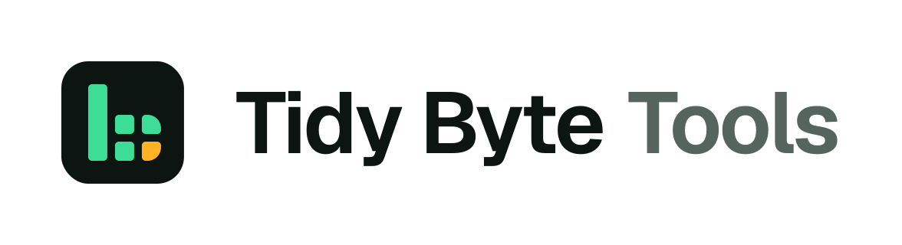
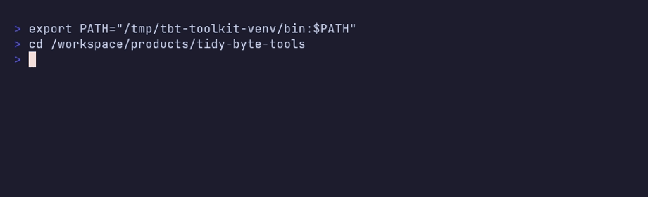

<p>
  <a href="https://github.com/tidybytetools">
    <picture>
      <source media="(prefers-color-scheme: dark)" srcset="https://raw.githubusercontent.com/tidybytetools/tidy-byte-tools/main/assets/tidybytetools-lockup-dark.png">
      
    </picture>
  </a>
</p>

# Tidy Byte Tools

[](https://github.com/tidybytetools/tidy-byte-tools/blob/main/LICENSE)
[](https://www.python.org/)
[](#use-it-from-claude-desktop-cursor-or-vs-code)
[](https://github.com/tidybytetools/tidy-byte-tools/actions/workflows/tests.yml)
[](https://github.com/tidybytetools/tidy-byte-tools/releases/tag/v0.1.1)

One install for our free local tools: fix broken JSON, pull tables out of a PDF, turn documents into Markdown, and more. It also starts **one MCP server** with all of those tools, so an AI assistant can use them on your computer. No API key.

This does not replace the individual lite repos. It is a doorway that installs them together.

<!-- mcp-name: io.github.tidybytetools/tidy-byte-tools -->

## Try it

This command is not valid JSON (the keys have no quotes, and there is a trailing comma):

```bash
printf '{name: "Ada", city: "Austin",}' | tidy-byte-tools json-repair -q
```

`-q` hides a one-line tip about the paid cloud version. Real output from that command (0.1.0, 17 Nov 2026):

```json
{
  "name": "Ada",
  "city": "Austin"
}
```



## Install

Needs Python 3.10 or newer. Install it from PyPI:

```bash
pip install tidy-byte-tools
```

Or use pipx, which keeps it in its own space:

```bash
pipx install tidy-byte-tools
```

That also installs the eight lite tools. All of them come from PyPI. (hash-lite's PyPI name is `tidy-hash-lite`.)

## Use it

```bash
printf '{name: "Ada", city: "Austin",}' | tidy-byte-tools json-repair
tidy-byte-tools pdf-table-pull report.pdf
tidy-byte-tools doc2md page.html -o page.md
tidy-byte-tools --help
```

`tbt` is a short name for the same command. Installing the package also gives you the original commands (`json-repair-lite`, `doc2md-lite`, and so on).

From Python, import a lite package directly:

```python
from json_repair_lite import repair_one
repair_one("{name: 'Ada',}")["value"]  # {'name': 'Ada'}
```

## Use it from Claude Desktop, Cursor, or VS Code

The MCP server talks over stdio. After you install the package, add one of these configs. If you would rather not install it first, `uvx` can run it straight from PyPI.

Claude Desktop (`claude_desktop_config.json`) and Cursor (`.cursor/mcp.json`):

```json
{
  "mcpServers": {
    "tidy-byte-tools": {
      "command": "uvx",
      "args": [
        "--from",
        "tidy-byte-tools",
        "tidy-byte-tools-mcp"
      ]
    }
  }
}
```

If the package is already installed, you can use `"command": "tidy-byte-tools-mcp"` and leave out `args`.

VS Code (`.vscode/mcp.json`):

```json
{
  "servers": {
    "tidy-byte-tools": {
      "command": "uvx",
      "args": [
        "--from",
        "tidy-byte-tools",
        "tidy-byte-tools-mcp"
      ]
    }
  }
}
```

The server exposes 15 tools. Base64 tools are named `base64_convert_text` and `base64_convert_file` so they are not confused with the document converter. Most tools only read. `save_chunks_jsonl`, `convert_to_markdown` (when you set an output path), and `extract_pdf_tables` can write the files you ask for. `check_links` requests the URLs you give it.

You can also start the server yourself with `tidy-byte-tools mcp`.

## The tools in this install

| Command | What it does | Lite repo |
| --- | --- | --- |
| `json-repair` | Repair broken or incomplete JSON, including output from language models | [json-repair-lite](https://github.com/tidybytetools/json-repair-lite) |
| `json-shaper` | Turn notes, CSV/TSV, or Markdown tables into typed JSON | [json-shaper-lite](https://github.com/tidybytetools/json-shaper-lite) |
| `base64` | Encode or decode Base64 for text and local files | [base64-lite](https://github.com/tidybytetools/base64-lite) |
| `hash` | Hash text or files with SHA-256, SHA-1, MD5, and SHA-512 | [hash-lite](https://github.com/tidybytetools/hash-lite) |
| `md-chunk` | Split Markdown into chunks by heading, for RAG | [md-chunk-lite](https://github.com/tidybytetools/md-chunk-lite) |
| `doc2md` | Turn a PDF or HTML file into clean Markdown | [doc2md-lite](https://github.com/tidybytetools/doc2md-lite) |
| `pdf-table-pull` | Pull tables out of a PDF into CSV | [pdf-table-pull-lite](https://github.com/tidybytetools/pdf-table-pull-lite) |
| `link-check` | Check web links for status codes and redirects | [link-check-lite](https://github.com/tidybytetools/link-check-lite) |

## Paid cloud tools and the API

If you want the same kind of work in the cloud, pay per use:

- Apify store: [https://apify.com/tidybytetools](https://apify.com/tidybytetools)
- HTTPS API: [https://tidybytetools.tidybytetools.workers.dev](https://tidybytetools.tidybytetools.workers.dev)

The site is [https://tidybytetools.github.io](https://tidybytetools.github.io).

## Limits

- These tools run on your computer. They are not a hosted service.
- `link-check` needs a network. The other tools work offline.
- The PDF tools read text PDFs. A scanned page with no text layer will not give useful tables or Markdown.
- This wrapper does not change how each lite tool works. See that tool's README for its flags and limits.
- In the Official MCP Registry as `io.github.tidybytetools/tidy-byte-tools`. You can also install the latest code from GitHub: `pip install git+https://github.com/tidybytetools/tidy-byte-tools`.

## License

MIT. See [LICENSE](LICENSE). Changes and ideas are welcome — see [CONTRIBUTING.md](CONTRIBUTING.md).
